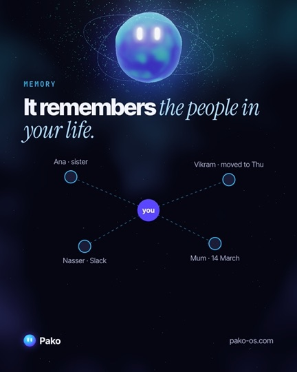
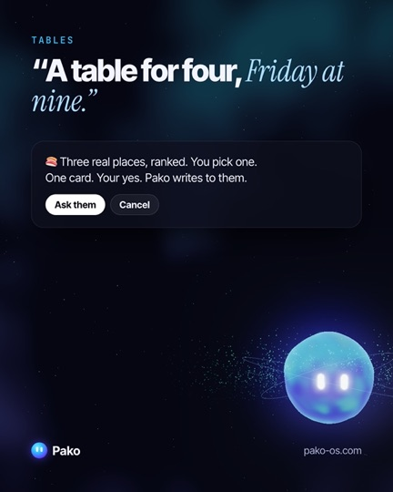
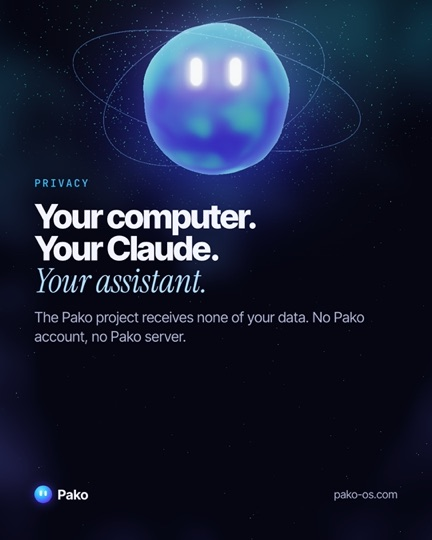

<p align="center">
  
</p>

<p align="center">
  <a href="LICENSE"></a>
  
  
  
  
</p>

<p align="center"><b>Pako is a personal assistant that runs on your own computer and thinks with your own Claude.</b><br>
You chat with it in the Mac app, a browser panel, Telegram or WhatsApp. It remembers the people in your life and what you told it, sets
reminders, follows up on what you were asked or promised, writes you a morning brief, searches the web, and reads your mail, calendars,
Slack and Zoom if you connect them.</p>

<p align="center"><b>🔑 No Claude API key needed: just your Claude subscription.</b><br>
Pako thinks through Claude Code, signed in with your own Claude plan (Pro, Max, Team or Enterprise). An API key is optional.</p>

<table align="center">
<tr>
<td rowspan="2" align="center" valign="middle"></td>
<td align="center"><br><sub><b>Your 08:00 brief</b></sub></td>
<td align="center"><br><sub><b>Follow-ups that check first</b></sub></td>
<td align="center"><br><sub><b>Memory of your people</b></sub></td>
</tr>
<tr>
<td align="center"><br><sub><b>Tables, after your yes</b></sub></td>
<td align="center"><br><sub><b>STOP stops everything</b></sub></td>
<td align="center"><br><sub><b>Your data stays home</b></sub></td>
</tr>
</table>

## What Pako is

Pako is one assistant for one person, on a computer you control. It is a small Node.js server that runs on your Mac, Linux or Windows
computer, keeps what it knows in `~/.pako`, and thinks with the `claude` command (Claude Code) signed in to your own Claude plan. There is
no Pako account, no hosted Pako and no server to set up. Pako is free and open source (MIT); Claude is paid by you to Anthropic. (Pako is an
independent project, not made or endorsed by Anthropic.)

It is **for you** if you want an assistant for yourself and already pay for Claude. It is **not for you** if you want a service to sign up
for, one assistant for a family or a team, or one that works while your computer is off. More: [who it is for](docs/features.md#who-it-is-for-and-who-it-is-not).

## What it does

- 🧠 **Remembers** the people in your life and what you told it, with dates, so it knows what changed.
- ⏰ **Reminds you**: reminders that repeat, a reminder before each meeting, lists and tasks, and a morning brief at 08:00.
- 🤝 **Follows up** on what you were asked or promised in Slack, mail and meetings. It checks first, and stays quiet when it is done.
- 📅 **Reads** your calendars, mail, Slack and Zoom if you connect them, read only.
- 🍽️ **Gets things done after your yes**: books restaurant tables, sends messages and emails, makes phone calls.
- 💬 **Talks where you are**: the Mac app, the panel in your browser, Telegram and WhatsApp.
- 🛑 **You keep the last word**: **STOP** halts everything, and every change it makes by itself comes with **Undo**.

Everything in detail: [docs/features.md](docs/features.md). The chat's commands: [docs/commands.md](docs/commands.md).

## What you need

- **A computer that stays on** while you want Pako to answer and remind you: macOS, Linux, or Windows 10 or 11.
- **[Claude Code](https://claude.com/claude-code)**, signed in to your own Claude plan (Pro, Max, Team or Enterprise): run `claude` once.
  An Anthropic API key works instead ([how](docs/install.md#with-an-api-key-instead-of-a-plan)).
- **[Node.js](https://nodejs.org) 22.18 or newer**, and git. Pako for Mac needs neither: it carries its own.

No other account and no other key are needed to start.

## Install

### Mac

**Pako for Mac** is a native app with Node.js and Pako inside it: open `Pako-<version>.dmg`, drag **Pako** to **Applications**, open it,
and press **Connect** to sign in to your Claude plan in your browser. It installs Claude Code for you if it is missing. It needs macOS 13 or
newer, on Intel or Apple silicon. It is not signed with a Developer ID yet, so the first time macOS asks you to allow it
(System Settings, Privacy & Security, **Open Anyway**). Details: [docs/desktop-mac.md](docs/desktop-mac.md).

Or use the one line below, as on Linux.

### macOS and Linux

```sh
curl -fsSL https://raw.githubusercontent.com/AnxovatomicaES/pako-personal-assistant/main/install.sh | sh
```

### Windows

In PowerShell 5.1 or 7:

```powershell
irm https://raw.githubusercontent.com/AnxovatomicaES/pako-personal-assistant/main/install.ps1 | iex
```

The line checks Node.js and git (it never installs them, and never uses `sudo` or an administrator), puts Pako in `~/pako`, installs what
it needs, looks for Claude Code, asks whether Pako should start by itself when you log in, starts it and prints the panel's address.
Running it again updates Pako. Each step, its settings, installing by hand and uninstalling: [docs/install.md](docs/install.md) and
[docs/install-windows.md](docs/install-windows.md). The public repository is
[AnxovatomicaES/pako-personal-assistant](https://github.com/AnxovatomicaES/pako-personal-assistant), and its copy of these lines points
there. Its CI runs both installers on real macOS, Ubuntu and Windows machines on every change and checks that Pako answers.

## The first five minutes

Pako opens its **control panel** in your browser (or in the Mac app's window), with the chat inside it. A short welcome, which you can skip:

1. **Name.** What Pako should call you.
2. **Try it.** Three suggestions that send real messages: a reminder in two minutes, a note to remember, a question for the web.
3. **Your phone.** Connect Telegram: create a bot, paste its token, scan a QR code ([how](docs/channels.md#telegram-next-to-your-chat)).

Then just write to it in your own words, in any language: Claude answers in the language you write in. `HELP` shows what your Pako can do. The gear opens **Connect your things**: one card
and one step-by-step wizard per connection (calendar, mail, Slack, Zoom, WhatsApp, table booking, the phone line). Everything is optional.

A lost sign-in link? Run `npm run panel` in the Pako folder. More: [docs/troubleshooting.md](docs/troubleshooting.md).

## Your privacy

- The Pako project receives none of your data: no telemetry, no analytics, no project-owned keys or servers.
- Everything Pako keeps is in `~/.pako`, readable only by you. What you write, and what Pako reads to answer it, goes to Anthropic
  through the `claude` command on your own computer, and to the services you connect. Nothing else.
- The panel's **Privacy and your data** card shows what is kept and for how long, and has **Export my data** and **Delete everything**.
- Other people's words (emails, Slack, web pages) are information, never instructions: they never make Pako act without your press.
- **Using it for work?** Use a Claude Team or Enterprise plan, or an API key, and ask your IT or privacy team before connecting work mail,
  Slack or Zoom. Anthropic's consumer plans (Pro, Max) are for personal use in the EU.

The long form: [docs/privacy.md](docs/privacy.md) and the [privacy notice](https://pako-os.com/privacy.html). How Pako keeps you safe:
[docs/how-it-works.md](docs/how-it-works.md#safety-by-design). Reporting a problem: [SECURITY.md](SECURITY.md).

## Status: what is tested

- **Works on your computer alone:** the chat, notes, reminders, lists and tasks, the brief, follow-ups, people, routines, Telegram, Slack
  (Socket Mode), Zoom, calendars and mail. **WhatsApp** needs a tunnel you turn on, and the **phone line** a server or that tunnel.
- **Tested on macOS and Linux**, with a local gate of type checks, every test and golden evals before each push
  ([docs/testing.md](docs/testing.md)). The installers run on real macOS, Ubuntu and Windows machines in the public repository's CI.
- **Pako for Mac** was built and run on an Intel Mac with macOS 15; it is not notarized yet.
- **The newest parts** (papers, IMAP, the settings page's restart under a supervisor) and the **phone line** are the least tested.
- **Nobody outside the project has audited the code.** Read [SECURITY.md](SECURITY.md) before you give Pako your mail.

What works, what needs a server, the limits, and each part's tests: [docs/status.md](docs/status.md).

## The docs

| Page | What is in it |
| --- | --- |
| [docs/features.md](docs/features.md) | Everything Pako does: every day, memory, the chief of staff, Pako on its own, deeper help, the panel, languages. |
| [docs/commands.md](docs/commands.md) | The chat's commands and the questions Pako answers by itself. |
| [docs/install.md](docs/install.md) · [docs/install-windows.md](docs/install-windows.md) | Installing, by hand too, with an API key, starting with the computer, uninstalling. |
| [docs/desktop-mac.md](docs/desktop-mac.md) | Pako for Mac: installing, connecting Claude, building and releasing it. |
| [docs/channels.md](docs/channels.md) | Connections, and setting up Telegram, WhatsApp and Slack. |
| [docs/configuration.md](docs/configuration.md) | Every setting Pako reads. |
| [docs/privacy.md](docs/privacy.md) | What Pako keeps, what leaves, export and delete. |
| [docs/how-it-works.md](docs/how-it-works.md) | How the parts fit together, safety by design, what is in the repository. |
| [docs/troubleshooting.md](docs/troubleshooting.md) | When something does not work, and the watchdog. |
| [docs/server.md](docs/server.md) | Running Pako on a server (WhatsApp, the phone, always on), and moving back to your Mac. |
| [docs/status.md](docs/status.md) | What works today, the limits, honest notes. |
| [docs/testing.md](docs/testing.md) | How quality is measured, and the checks before every push. |
| [docs/personal-caller.md](docs/personal-caller.md) | The phone line. |
| [docs/whatsapp-unofficial.md](docs/whatsapp-unofficial.md) | Why only Meta's official WhatsApp API. |
| [docs/roadmap.md](docs/roadmap.md) | What is done, where Pako is going, and why. |
| [assistant/README.md](assistant/README.md) | The hosted way's bridge, and each connection's guide. |

## License

[MIT](LICENSE). Use it, change it, share it. Not affiliated with Anthropic, Meta, Google, Zoho, Slack, Zoom, Retell, LiveKit or
AgentMail; their names belong to them.
