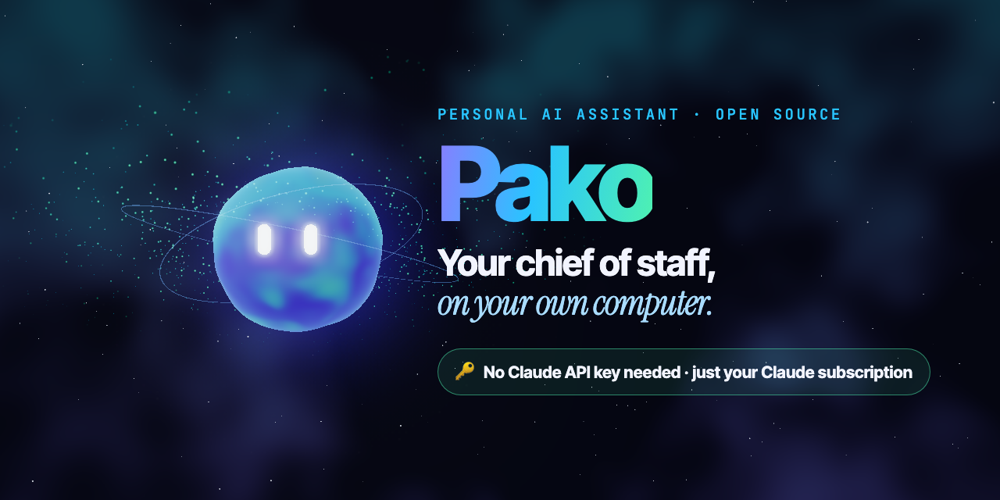
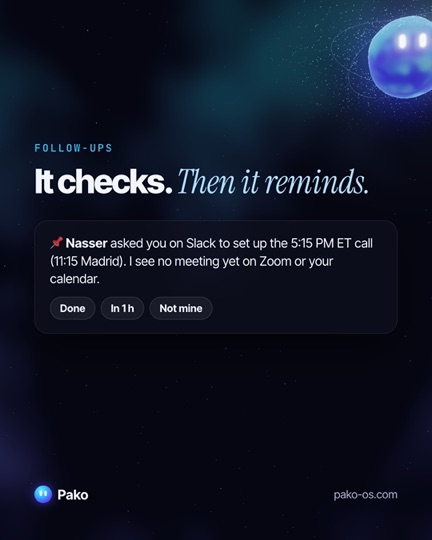

<p align="center">
  
</p>

<p align="center">
  <a href="LICENSE"></a>
  
  
</p>

<p align="center"><b>Nothing you promised, or were promised, gets dropped.</b><br>
Pako is a personal assistant on your own computer that thinks with your own Claude: <b>your Claude subscription, no API key.</b></p>

<table align="center">
<tr>
<td rowspan="2" align="center" valign="middle"></td>
<td align="center"><br><sub><b>Your 08:00 brief</b></sub></td>
<td align="center"><br><sub><b>Follow-ups that check first</b></sub></td>
<td align="center"><br><sub><b>Memory of your people</b></sub></td>
</tr>
<tr>
<td align="center"><br><sub><b>Tables, after your yes</b></sub></td>
<td align="center"><br><sub><b>STOP stops everything</b></sub></td>
<td align="center"><br><sub><b>Your data stays home</b></sub></td>
</tr>
</table>

## What makes it smart

- **It notices.** Promises made to you in Slack, mail and meetings, and the ones you make, in your own messages and in chat.
- **It checks before it reminds.** Your calendar, Zoom and Sent mail: if you already replied or met, it closes the loop quietly.
- **It gets ahead.** Meeting prep before each meeting, what changed overnight, and a morning brief where every line cites its source.
- **It drafts.** A reply ready for every follow-up, in your tone, and better with every correction you make.
- **It remembers.** The people in your life, with dates: what you last agreed and what is open both ways.
- **It listens only to you.** Instructions hidden in other people's messages are ignored. **STOP** halts everything; every action has **Undo**.

## Gentle mode: built with ADHD brains in mind

Opt-in, in Settings → How Pako acts.
- **"Did it happen?"** Nudges ask once, with Done, Snooze or Park. There are at most 4 a day, and none after two you ignored. There are no red overdue counts and no streaks.
- **Time anchors.** "Wrap up" before a call, "your call starts in 5", and "this usually takes you about 40 min".
- **A first tiny step** for anything stuck, and a **brain dump**: one messy message, sorted into reminders, promises, tasks and notes.
- **Check-ins** ("check on me at 10:30") and a **weekly reset**: "3 things are slipping: pick one, I'll park the rest."

It's a productivity feature, not a medical device or a treatment. Details: [docs/features.md](docs/features.md#gentle-mode).

Everything in detail: [docs/features.md](docs/features.md). Chat commands: [docs/commands.md](docs/commands.md).

Experimental features (table booking, phone calls, WhatsApp, the Relay) are in Labs, off by default: [Core and Labs](docs/features.md#core-and-labs).

## What you need

- A computer that stays on: macOS, Linux, or Windows 10 or 11.
- **[Claude Code](https://claude.com/claude-code)** signed in to your Claude plan (Pro, Max, Team or Enterprise). An API key also works
  ([how](docs/install.md#with-an-api-key-instead-of-a-plan)).
- [Node.js](https://nodejs.org) 22.18+ and git, except with Pako for Mac, which carries its own.

Pako is free and open source (MIT). Claude is paid by you to Anthropic. Pako is independent, not made or endorsed by Anthropic.

## Install

**Mac:** open `Pako-<version>.dmg` from [Releases](https://github.com/AnxovatomicaES/pako-personal-assistant/releases), drag Pako to
Applications, and press **Connect** to sign in to Claude. Not notarized yet: the first time, allow it in System Settings, Privacy & Security
([details](docs/desktop-mac.md)).

**macOS and Linux:**

```sh
curl -fsSL https://raw.githubusercontent.com/AnxovatomicaES/pako-personal-assistant/main/install.sh | sh
```

**Windows** (PowerShell):

```powershell
irm https://raw.githubusercontent.com/AnxovatomicaES/pako-personal-assistant/main/install.ps1 | iex
```

The installers never use `sudo` or an administrator, and running them again updates Pako. Step by step: [docs/install.md](docs/install.md),
[docs/install-windows.md](docs/install-windows.md).

Pako then opens its panel with the chat inside. Write in your own words, in any language; `HELP` lists what it can do. The gear connects
calendar, mail, Slack, Zoom, Telegram and WhatsApp, each optional.

**Try the demo:** press **Try with a demo week** in the welcome (or **Try the demo week** in the Mac app, or `PAKO_DEMO=1 npm start`): an
invented week with the brief, follow-ups and drafts working at once, nothing sent. **Leave demo** deletes it.

## Privacy

Everything Pako keeps stays in `~/.pako` on your computer. The project receives none of your data: no telemetry, no analytics, no servers.
What Pako needs to answer goes to Anthropic through `claude` on your computer, and to the services you connect. Export or delete it all
from the panel. For work data, use a Team or Enterprise plan or an API key, and ask your IT team first.
More: [docs/privacy.md](docs/privacy.md), [SECURITY.md](SECURITY.md).

## Status

Tested on macOS and Linux, with type checks, about 1,700 tests and golden evals before every push; the installers run on macOS, Ubuntu and
Windows in CI. Pako for Mac is not notarized yet, and nobody outside the project has audited the code. Details: [docs/status.md](docs/status.md).

## Docs

[Features](docs/features.md) · [Install](docs/install.md) · [Mac app](docs/desktop-mac.md) · [Connections](docs/channels.md) ·
[Settings](docs/configuration.md) · [How it works](docs/how-it-works.md) · [Troubleshooting](docs/troubleshooting.md) ·
[Server](docs/server.md) · [Testing](docs/testing.md) · [Roadmap](docs/roadmap.md)

## License

[MIT](LICENSE). Not affiliated with Anthropic, Meta, Google, Zoho, Slack, Zoom, Retell, LiveKit or AgentMail; their names belong to them.
