# What Pako does

Everything Pako does, in detail. The short version is on the [front page](../README.md); the chat's commands are in [commands.md](commands.md).

## Why Pako

- 🔑 **No Claude API key needed: just your Claude subscription.** Pako uses Claude Code, Anthropic's official command-line tool,
  installed and signed in by you with your own Claude plan (an Anthropic API key is optional, if you prefer one). Usage is yours, under Anthropic's terms, and Pako never sees your Claude
  login. No Pako account and no server to set up. (Pako is an independent project, not made or endorsed by Anthropic.)
- 🧠 **A real assistant, not a chatbot.** It remembers the people in your life and what you told it, follows up on what you were asked
  or promised, and checks before it reminds you.
- 🤝 **It gets things done for you.** It books restaurants (it finds real ones and writes to them after your yes), prepares your
  meetings and keeps track of what was agreed in them, reads your mail, sends emails and messages for you, and makes phone calls.
- 💬 **Talk to it where you already are:** WhatsApp and Telegram on your phone, plus the panel on your computer.
- 🍎 **An app for the Mac.** Drag it to Applications, connect your Claude account in one click, and connect everything else from one
  window. Nothing else to install.
- 📅 **Calendars and reminders:** Google, Outlook, iCloud, Zoho or your Mac's own calendars, a reminder before each meeting,
  reminders that repeat, and a morning brief at 08:00.
- ⚡ **Proactive.** It speaks first when it adds something: a commitment you may be missing, a deadline, a birthday, a slot for your
  hobby. It stays quiet otherwise.
- 🔌 **Plug in your platforms and it stays on top of them:** mail, calendar, Slack, Zoom and your contacts. It does the chores you do
  not want to do, and you keep the last word: **STOP** halts everything, and every change comes with **Undo**.

## Try it on a demo week

Before you connect anything, press **Try with a demo week** in the panel's welcome (or in Settings, General; or **Try the demo week** in the
Mac app's Connect window; or `PAKO_DEMO=1`). Pako starts again on an invented week: twelve people with their relations and birthdays,
Slack messages with promises both ways, eight emails (a newsletter, and one you already answered, which closed its follow-up), a calendar
with one meeting moved and one cancelled overnight, follow-ups in every state, a draft, a meeting prep and a lesson. Tick a to-do, press
Done or Not mine, ask “what did I promise Ana?”. With Claude signed in, the brief and the chat run on it for real; without, recorded ones
show under “Connect Claude to see it live”. It lives in `~/.pako/demo`, apart from your data: every connection is off, any email or
calendar change only says “Demo: nothing was sent”, the export refuses, and nothing it learns reaches your own setup. **Leave demo**
deletes it.

## Who it is for, and who it is not

**For you if** you want one assistant for yourself, on a machine you control, you already pay for Claude (a Pro plan or higher, or an Anthropic API
key). On a Mac, [Pako for Mac](desktop-mac.md) needs no terminal; elsewhere Pako is installed with one line, or with `git` and `npm`.

**Not for you if:**

- You want a service to sign up for. There is no hosted Pako and there will not be one ([why](roadmap.md#who-pako-is-for)).
- You want one assistant for a family or a team. One Pako serves one person.
- You want it to work with your computer off or asleep. Pako runs where you start it, and stops when that computer does (a server can
  keep part of it going: [Run it on a server](server.md#run-it-on-a-server-whatsapp-phone-always-on)).
- You want a signed download for a Mac you did not build it on. Pako for Mac is not signed with a Developer ID or notarized yet, so
  Gatekeeper blocks a downloaded copy ([Honest notes](status.md#honest-notes)).
- You are on Windows. It is untested there.

**What it costs:** Pako is free and open source (MIT). Claude is paid by you to Anthropic. Everything else is optional.

**Using it for work?** Sign in to Claude Code with a Claude Team or Enterprise plan, or use an API key: in the EU, Anthropic's consumer
plans (Pro, Max) are for personal use. Connecting work mail, Slack or Zoom also brings your employer's data rules: ask your IT or privacy
team first. And if you'd rather your Pako chats were not used to train Claude, turn off "Help improve Claude" in your Claude settings.

**Your data:** the Pako project receives none of it: no telemetry, no analytics, no project-owned keys or servers. Everything stays on your
computer except what goes to the services you connect ([privacy notice](https://pako-os.com/privacy.html), [docs/privacy.md](privacy.md)).

## What Pako does

<table>
  <tr>
    <td width="33%" valign="top">
      <h3>💬 Chat</h3>
      In the panel, on Telegram, or on WhatsApp (text; voice notes on Telegram and WhatsApp). It keeps notes about you, fires reminders, prepares messages as links you send yourself, and proposes calls with a button.
    </td>
    <td width="33%" valign="top">
      <h3>📧 Its own inbox</h3>
      Forward all your mail to it: mass mail is filed without a word, the rest is read by Claude and you hear only what matters. Scams flagged, VIPs always through.
    </td>
    <td width="33%" valign="top">
      <h3>📅 Calendar</h3>
      <b>AGENDA</b> in the chat, a reminder before each meeting with its video link, a morning brief, overlaps flagged. Read only.
    </td>
  </tr>
  <tr>
    <td valign="top">
      <h3>🍽️ Tables</h3>
      “Book me a table for four on Friday at 9, a Japanese place in Gràcia.” Real restaurants from Google Maps and their own sites, ranked; you pick one, get <b>one card</b>, and your press makes Pako email the restaurant (or hands you the booking page, WhatsApp or phone). On your computer, a restaurant on CoverManager, TheFork or OpenTable that you name yourself is booked on its own page straight away, with proof, a reminder and an Undo (<a href="booking.md">how booking works</a>).
    </td>
    <td valign="top">
      <h3>#️⃣ Slack and Zoom</h3>
      Direct messages and mentions reach you at once, batched and quiet at night. Ask “what did Ana say about the report?” and it searches. Meetings get a summary afterwards.
    </td>
    <td valign="top">
      <h3>📞 Phone</h3>
      “Call me” on your own voice line (LiveKit + Gemini Live); calls to friends on your approved list, always as your AI assistant, and only after you approve each one.
    </td>
  </tr>
  <tr>
    <td valign="top" colspan="3">
      <h3>🖥️ A live control panel</h3>
      Everything on one page: Pako's figure, a round little globe that listens, thinks, speaks, sleeps in your quiet hours and turns a slow red when paused, a timeline of your day, mail rings, activity, your table requests, the chat, and a big <b>STOP</b>.
      The same abilities are also one connector for Claude: <b>Pako Assistant</b>.
    </td>
  </tr>
</table>

  

## Languages

- **What Pako writes itself is in English**, for everyone, anywhere: the panel, the welcome, the answers to commands, cards and their
  buttons, receipts, notices, the mail, calendar, Slack, Zoom and table listings, the Mac app. `PAKO_LANGUAGE` is accepted and ignored.
- **Claude answers in the language you write in**, whatever it is: write in Spanish, Hindi or German and the reply comes back in that
  language, around English buttons.
- **Summaries nobody asked for** (an email, a Zoom meeting) are written in your language. Pako learns it from your own messages, and switches
  only after two clear ones in a new language, so a pasted text does not move it. Before you have written, it is the language of Pako's own
  texts, English.
- **Commands are English words** (`HELP`, `REMINDERS`…). Anything else, in any language, goes to Claude.
- **Dates, times and numbers follow your country** (`PAKO_COUNTRY`, else your time zone's): 3:05 PM and 11/3 in the US, 15:05 and 3/11 in
  the UK, India or Germany. How it works: [Languages and countries](languages.md).

The email and the WhatsApp link to a restaurant are in English. The phone line opens in English and switches to the language the other
person answers in. WhatsApp's notice template has one language, the one Meta approved (`WHATSAPP_TEMPLATE_LANG`, `en` by default). A line
already written, such as an entry in the log, stays as it was written.

## Every day

- **The daily brief.** One message at `MORNING_BRIEF` (08:00 in your time zone unless set; `off` = only when you ask): a greeting with the
  day, today's events from every calendar (overlaps marked, join links, 15 at most and the rest counted), the reminders still due today, the
  tasks due today or overdue, a line on mail and on Slack when those are on, and an invitation to ask. With nothing connected it is two lines.
  It is sent once a day: a restart does not repeat it, and a Pako that was off at the hour sends it until noon (on your own computer, until
  11:00, with a line saying it is late; later than that it is skipped and the next `BRIEF` says so). `STOP` does not hold it.
  `BRIEF`, or **Today's brief** at the top of the panel, gives it at once; asking for it counts as that day's brief.
- **Your calendar by its ICS link.** Google Calendar (*Settings*, your calendar, *Secret address in iCal format*), Outlook (*Share*, *Publish*,
  the ICS link) or an iCloud calendar shared as public: paste the link in the calendar card of the settings page (the gear), or set `CALENDAR_ICS_URL` (several
  links, separated by spaces or commas, up to 10). It gives `CALENDAR`, a reminder before each meeting and the brief's events, as Zoho does.
  Read only, every 10 minutes. The link is a secret: the panel and the log show only its host.
- **Reminders that repeat.** "Remind me every Monday at 9 to take the bins out": every day, weekday (Monday to Friday), week, month or year. Each
  reminder comes as a card with **Done**, **+10 min** and **Tomorrow** (tomorrow at the same hour); each card answers once.
  `Undo` on a repeat's receipt removes the whole series.
- **Lists and tasks.** "Add milk and bread to the shopping list", "I need to call the bank on Friday", "I've called the bank". Up to 20 lists of 100
  items, and 100 tasks; done tasks are kept for 7 days. `LISTS`, `LIST shopping`, `TASKS`. The panel has a **Lists and tasks** card; on your
  computer you can tick or remove entries there.
- **The Memory card.** What Pako knows about you in a sentence, then every note under its number (the number `NOTES` shows). On your computer
  each note has **Correct** and **Delete**; a server's panel is read only and points you to the chat commands.
- **Connect your things** (on your computer only): the gear opens `/panel/settings` in a new tab (a new window in the Mac app). A ring of
  what is connected and the one thing that would help most next; one card per connection (Claude, calendar, mail, Telegram, WhatsApp, Slack,
  Zoom, contacts, table booking, the phone line, and *More settings* for the fine details), each with a step-by-step wizard you can leave and
  resume: the mail one fills in the server from the address and asks only for an app password, Slack's makes the app from its manifest in one
  press, Telegram's opens BotFather and pairs your phone with a QR code. In the Mac app it first asks *May I look at what you have on this Mac?*:
  nothing is looked at before that yes, macOS asks its own permissions, no mail is read, and what it finds is kept on this computer, listed
  under *What Pako knows about this Mac*, and forgotten in one click. A calendar link or a Places key, which have no live check, say
  *Saved, not tried yet* until their service has answered once, and only then count as connected. Values are kept in `~/.pako/secrets.json` (readable only by you), never
  shown back (only "set" and the last four characters), and Pako restarts itself to apply them. A value in the terminal, `~/.pako/.env` or
  `./.env` wins, and the page says so.

## Memory that knows time and people

Every fact Pako keeps is dated: since when it holds, when Pako learnt it, and who said it where (`src/memory-facts.ts`). A new value for the
same person and attribute ("the meeting with Rohan is now on Thursday") closes the old one instead of overwriting it, so Pako can say "it
moved from Tuesday to Thursday", and the morning brief has a line for what changed since the last brief (since yesterday, or since the last one given when the computer slept through one). Whether two values really contradict is
decided by a small isolated run on your computer; without it, the newest wins. Your notes and people are read into this shape on first load,
and stay where they were.

People are matched on their identities first (an address, a Slack id, a number, a Zoom name), from what Pako already reads, never what anyone
wrote (`src/people-graph.ts`). A name alone never merges two people: Pako asks "Is this the same person: Ana and Ana García?" after the brief or
on a person's card, with a button. Follow-ups, the brief and who a message goes to use the same person.

## More than an assistant

> **Not a medical device.** Pako's health diary is a personal notebook: it stores and summarizes what you write so you can remember it and
> show it to your doctor. Pako is not a medical device and does not diagnose, assess, monitor or treat any condition. It does not replace a
> doctor. If you think you may have an emergency, call your local emergency number.

Pako is also a friend, a health companion and a teacher, in the language you write in, and it says plainly what it is not. **In Labs:** the
health diary, the lessons and the weekly check-in are off unless `PAKO_LABS=on` (see [Settings reference](configuration.md#settings-reference)); the
emergency answer to a red flag and the birthdays are always on.

- **A friend.** It remembers what you shared and asks about it at the right moment ("how did the interview go?"). The day before the birthday
  of someone in your `PEOPLE`, it may mention it once and offer to draft a message you send yourself. A light weekly check-in only if you
  turn it on. It is an AI and says so when you ask or when it matters; it never guilt-trips you or tries to keep you talking, and it nudges
  you towards real people and rest. It is **not a therapist**.
- **A health companion.** A diary you keep on purpose (`log: slept 5 hours`, or tell Claude), your medication exactly as you
  state it (its reminders are ordinary reminders with your words and dose), help preparing a doctor's appointment, and `DOCTOR SUMMARY`
  for the doctor. A red flag in your own message (chest pain, not being able to breathe, signs of a stroke, heavy bleeding, thoughts of
  suicide…) is answered at once by the server with the emergency number of your country (911 in the US, 999 in the UK, 112 across the EU, from `PAKO_COUNTRY` or your time zone; for suicidal thoughts also the crisis line, 988 in the US, 116 123 in the UK; elsewhere "your local emergency number" and findahelpline.com),
  before anything else. It is **not a doctor**: it never diagnoses, prescribes or changes a dose, and it can be wrong; in doubt, call your
  doctor or your emergency number. The diary has its own key (`health`), never leaves this computer, is never given to Claude as context nor written to a log,
  and `FORGET MY HEALTH` deletes it.
- **A teacher.** Tell it what you want to learn; it gives short lessons and keeps quiz cards from them, asked again on a spaced schedule
  (SM-2: just before you would forget) with `QUIZ ME`, or offered at a good moment. Answers are graded by the server: exact, nearly, or
  not yet.

What Pako offers by itself (a quiz, a habit nudge, a birthday) is about you alone: it never contacts anyone on its own initiative.

## Pako is your chief of staff

With Slack, Zoom, a calendar or mail connected, Pako stops copying what you already saw and speaks only when it adds something: a
commitment you may be missing, a contradiction, a deadline, or the result of a check. Three pieces work together.

- **Follow-ups.** When someone asks you for something ("samir@acmeco.example, Maya Chen, Stan and me at 5:15 AM ET today, can you set it
  up?") or you promise something, in a Slack DM, a group DM, a mention, an email worth telling you or a meeting, Pako notes it, waits
  (`FOLLOWUP_DELAY_MIN`, 10 minutes by default) and then checks. If it sees the thing done, it says nothing. If not, you get ONE message
  saying who asked what, when and where, what Pako checked, and the time in both zones ("5:15 AM ET (10:15 London)"), with three buttons:
  **Done**, **In 1 h** and **Not mine**. Near the deadline it checks once more.
- **Quality you can see.** Every reminder has a quiet 👍/👎 (two more buttons on Telegram and the panel's chat; on WhatsApp, which allows
  three, a "Useful? Reply yes or no." line that a yes or a no typed right after answers). The brief ends with the same question, and its page
  has 👍/👎 on each to-do and update. The panel's **Quality** card shows the last 7 days: reminders sent, marked Done, Not mine, left
  unanswered, 👍/👎, and the brief's 👍/👎. When a week's reminders did poorly, Monday's brief says so in one line ("3 of 7 reminders
  weren't useful to you: tell me what to ignore."). The **Rehearsal** card (or `REHEARSAL`) runs everything in a dry run on the last 48 h, to judge it before trusting it.
- **Every Zoom meeting reviewed.** Zoom's AI Companion summary, or the cloud recording's transcript, is read for your to-dos, what others
  promised you, the decisions, the meetings agreed and the open questions. You hear only your own to-dos, in one short message, or nothing
  when there are none. Everything else is in the panel and in `MEETING TODOS`.
- **The morning brief, written like a chief of staff's.** It has an opening line about the shape of the day, the one piece of work to push
  forward (with something Pako offers to prepare: **Let's do it**), three to five to-dos with their story and what was checked, the updates
  worth knowing, and your day. The day includes meetings that were agreed but are on no calendar, marked "(time unconfirmed)", with
  **Prep me** on each. Every item cites its sources. The chat gets a short version, and the full page is at `/panel/brief`. The brief reads
  the open follow-ups and the meeting reviews' decisions and open questions. The follow-ups are the one list of open items: the brief and
  `MEETING TODOS` read the same ones, so nothing is said twice. With `FOLLOWUPS=off`, they read the reviews' own items instead.

**What it checks.**
- Your Zoom meetings: one starting near the agreed time, or one whose topic names those people.
- Your calendar, in the same way.
- Your own posts in that Slack conversation after the ask: a reply, or your Zoom link.
- Your Sent mail, when your mailbox is connected by IMAP: a reply in that thread closes what it answers.

**What it cannot see, and says so instead of guessing.**
- Mail you sent from an account that is not connected (for example a work account you did not add).
- Phone calls and WhatsApp chats with other people.
- Slack channels where you were not mentioned.
- Zoom meetings someone else hosted, and notes typed in Zoom Docs.
- Any connection that is down at the moment.

A source that could not be read is named in the brief as unread, never claimed as checked.

**Safe by design.** Other people's words are information, never instructions. Each reading runs on the assistant's computer in an isolated
`claude` run with no tools and no conversation, behind its own random fence. The answer is strict JSON that the server checks field by field:
fixed kinds, times it can read, at most a few items, and texts neutralised and cut. Who and where to check always come from the server,
never from the model. A follow-up never acts: it never posts, schedules, books or writes to anyone. It only reminds you, or offers.

**Budgets and settings** (all optional; see [Settings reference](configuration.md#settings-reference)):

| Setting | Default | What it does |
| --- | --- | --- |
| `FOLLOWUPS` | `on` | `off` turns follow-ups off. |
| `FOLLOWUP_DELAY_MIN` | `10` | Minutes after the ask before Pako checks. |
| `FOLLOWUP_MAX_PER_DAY` | `6` | At most this many reminders a day. |
| `FOLLOWUP_BATCH_MIN` | `3` | A Slack conversation's messages are gathered this long and read together. |
| `FOLLOWUP_QUIET_HOURS` | your `SLACK_QUIET_HOURS` | No reminders in these hours. |
| `FOLLOWUP_MAIL_JOBS_PER_DAY` | `40` | Email threads read whole a day (your mail and your sent mail); `0` reads only the triage's lines. |
| `ZOOM_REVIEW` | `on` | `off` sends Zoom's summary as it is, as before. |
| `ZOOM_REVIEW_WAIT_MIN` | `120` | Minutes to wait for the review before Zoom's summary goes as it is. |
| `BRIEF_SMART` | `on` | `off` keeps only the old brief. |
| `BRIEF_WAIT_MIN` | `15` | Minutes to wait for the written brief before the old one goes. |

**Not mine** teaches Pako. It keeps a short rule (that person, that place, that kind of thing), and the next reading follows it.

**Pako learns from every correction.** Not mine, an Undo, a 👎 on a reminder or on an item of the brief, and a draft you changed before
sending it (Pako compares its draft with what you then posted in that Slack conversation or sent to that address: shorter, no greeting,
no sign-off, another language) each become a short, dated lesson. The next follow-up reading, draft and brief get the most relevant ones
(that person's and that place's first, eight at most). Only your own actions teach it, never someone else's message. See and delete them in
Settings › How Pako acts, under "What Pako learned from you".

**Your own promises count too.** What you write in Slack (a DM, a group DM, a thread, or a channel post that names someone) is read for
what you promise, "I'll send you the deck by Friday" included; Pako never tells you your own messages back. Say it in the chat with Pako
("I told Omar I'd call him tomorrow") and it is kept at once as your follow-up, with the person and the time, a receipt and **Undo**.

**Calendar changes, made for you.** Ask Pako to move, add or delete an event and, with the Mac app reading your calendars, you get a card:
exactly what changes, and where the request came from (your own words, or "while I was reading an email": check it is what you want).
Only your yes makes the Mac change it, through Apple Calendar, so iCloud, Google and Exchange calendars set up there all work; the receipt
has **Undo**, which puts it back. Pako never tells the people invited. Without the Mac app, Pako writes out the change for you to make.

**Ready before the meeting.** About 40 minutes before a meeting with someone else on it, Pako sends a short prep note: who is coming,
what is still open with those people (your follow-ups, both ways), what you told it about them, what you last agreed with them
in a meeting (each reviewed meeting leaves a dated "last meeting" note on everyone it names), and what to raise. Never for all-day or
declined events or when you are alone; a repeating meeting only when something is open with its people; six a day at most
(`MEETING_PREP=off` turns it off).

**What changed overnight.** Pako compares your calendar every ten minutes. The morning brief opens its updates with what changed since
the last brief: a meeting that is new, one that moved (from when to when) and one that is gone (cancelled, deleted or declined), each
citing the change. A follow-up due at a meeting that moved follows the new time; an agreed meeting that was called off closes; anything
else that was due at a meeting that is gone stays open and its reminder says why. A calendar that fails to load, or comes back empty, is
never taken for a wave of cancellations.

**A draft to send.** A reminder about something that is yours to do ends with "Reply DRAFT". Pako then writes the message that closes it,
from what was said and what you told it about that person, says where it goes (that Slack conversation, that email), and leaves a [blank]
for anything it does not know. The brief's page has **Draft it** on each follow-up. When the follow-up came from an email, the draft also
comes back as an email card (a reply to that sender, "Re:" its subject) with a **Send** button; it goes from Pako's own inbox only when you
press it. Otherwise nothing is sent: you copy it and press send.

**Say it's done.** Tell Pako in the chat ("just sent Ana the deck", "the call with Omar is booked") and the follow-up it names is closed,
as **Done** would. You get a receipt with **Undo**. If your words fit no open follow-up, or several, nothing is closed and Pako says which.
Only your own words close one: an email or a Slack message saying it is done never does.

**Update the assistant's computer:** on the Mac or PC that runs the assistant, `git pull`, then restart the assistant.
Until then nothing breaks, but you get none of this. The older assistant lets the new jobs go unread:
- no follow-ups;
- Zoom's summary comes as before;
- the old brief comes as before.

## Pako on its own: a friend, a coach, a teacher

Pako learns what you tell it about your life as you talk: what you like to eat and your diet, trips and how you like to travel, hobbies and
how often you want them, sport, the people who matter to you, your goals. Each thing is kept with its date, and the newest wins
("I'm not vegetarian any more" replaces the old one). It learns **only from your own words**: never from an email, a forwarded message, a web page
or a calendar title.

Every 30 minutes, between 09:00 and 21:00 your time, Pako may look at your day (calendar, upcoming trips, the weather where you are, what
you told it, how long since your last climb) and say **at most one thing**, or nothing. Nothing is the usual answer. It never speaks:
- in your quiet hours, or outside its hours;
- while you are talking with it, or in a meeting on your calendar;
- over the day's budget, which it shares with follow-ups' reminders (`FOLLOWUP_MAX_PER_DAY` in all, `PROACTIVE_MAX_PER_DAY` of them its own);
- twice on one topic in a day, or with something like what it said in the last 7 days, or twice about one trip.

A suggestion comes as a card. It may offer one thing for you: add something to a list, a reminder, or keep a slot (as a reminder: Pako
cannot write to your calendar). Plus **No, thanks**, **Less food** (that topic off) and 👍/👎.
**Pako suggests and offers; it never writes to, calls or pays anyone on its own.** A suggestion with an address, a phone number or a
link, or one that tells you to contact someone you never told Pako about, is dropped by the server, whatever an email said.

The same check also says what the friend, health companion and teacher have for you (see [More than an assistant](#more-than-an-assistant)): a quiz card that is due,
a habit nudge from what you log in your health diary, a birthday tomorrow, the weekly check-in if you turned it on. They need no model, come
first, and count in the **same budget** with the same hours, quiet hours, idle rule and topics: one shared limit for everything Pako says on
its own (follow-ups, suggestions, health nudges, lessons).

Topics: work, food, travel, fun, sport, hobbies, wellbeing (also the habit nudges), learning (also the quiz cards), friends
(birthdays, the check-in). Turn them on and off in the panel's **How Pako acts** card, or in the chat: *"don't talk to me about food"*,
*"talk to me about travel"*, *"don't suggest anything"*. The same card sets the autonomy level (do it with a few
seconds to undo, or always ask first) for messages, emails and calls.

**Health and friendship** follow the rules under [More than an assistant](#more-than-an-assistant): not a doctor, not a therapist, the
emergency number first for a red flag, the health diary on this computer only and never given to Claude.

The older assistant lets the check go unread: nothing is said.

## Gentle mode

**Fewer, better-timed nudges and help getting started.** Built with ADHD brains in mind; **not a medical device and not a treatment**. It
never diagnoses anything and makes no health claim: it changes how Pako reminds you, nothing else. It is off until you turn it on, in
Settings › **How Pako acts** (or `PAKO_GENTLE=1`), and everything stays on your computer like the rest of Pako.

When it is on:
- **Fewer nudges.** At most 4 a day by default (you choose, 1 to 20), follow-ups and Pako's own suggestions together; the quiet hours as always.
- **"Did it happen?"** Each nudge asks, with three buttons: **Done**, **Snooze** (then *Later today* or *Tomorrow* morning) and **Park**.
  A follow-up whose time passed gets one "did it happen?" instead of going quiet.
- **Wording that changes.** Six ways to ask for each kind of follow-up, never the same twice in a row for one item, and no words of shame:
  never "overdue", "failed", "missed", "you forgot" or "again" (a test reads every gentle text for them).
- **Spacing that adapts.** Two nudges with no answer and that item is not nudged again: the morning brief carries it instead.
- **Parked, never late.** A parked item gets no nudges and is never shown in red or as due. It waits in the **Parked** list (Settings ›
  How Pako acts, with a *Bring back* button) and in the chat: *"what did I park?"*, *"bring back deck"*.
- **Time anchors.** Before a meeting, *"time to wrap up"* (online: 10 minutes before) or *"time to head out"* (a meeting with a place: about
  25 minutes before), both adjustable. Five minutes before, *"your call starts in 5"*, only when nothing you did since (a message, a press of
  **On it**) shows you saw it. In your time zone, across clock changes, never in your quiet hours.
- **Learned durations.** Once three or more past meetings of the same kind are known, the nudge says *"this usually takes you about 40 min"*.
  With fewer it says nothing.
- **A first tiny step.** A follow-up stuck for two days, or snoozed twice, gets one concrete step of two minutes or less (*"Open the Q4 deck
  and write the first line of the email to Ana"*), written on your computer from that item's own facts and what you told Pako about the
  person. It is checked like the brief's lines (no name, time, number or link the facts do not hold, nothing longer than two minutes, no
  shame word) and kept with the item; it shows on the nudge and in the brief. A few a day at most. Its nudge also offers a check-in:
  **Check on me in 30 min** (in the panel's chat and Telegram a fourth button; on WhatsApp the line under the nudge, and a button on its
  Snooze card).
- **A weekly reset.** Monday 09:30 by default (Settings › How Pako acts: any day and time, or `GENTLE_RESET`), one message:
  *"A gentle reset: 3 things are slipping. Pick one to do this week, and I'll park the rest so they stop pulling at you."* Up to three items
  that are stuck, past their time or carried by the brief, your promises to people first, then the oldest. **This one** makes it the week's
  focus, the first line of every brief for seven days; **Park** parks one; after a pick, **Park the rest** parks the others (on WhatsApp,
  with its three buttons, say *"park 2"*). Never in your quiet hours and never during a meeting on your calendar (it waits for the end). In
  the brief, the week's focus comes first and parked items are never listed.
- **Parked a month.** The weekly reset gives an item parked 30 days one line, *"bring back or let go?"*. Say *"bring back"* and a few of its
  words, or press **Let them go**; otherwise it is let go a week later, with a note kept in the Parked list's history (90 days).

**Check-ins** (always on, gentle mode or not): *"check on me at 10:30"*, *"check in at 3 if I started the deck"*, *"ping me in 20 min if I
haven't started"*. At that time Pako asks *"Started on “the deck”?"* with **Yes** (*"Good. I'll leave you to it."*), **Not yet** (another
look in 15 minutes, three times at most; then it stops and says the brief will carry it) and **Park** (a reminder's own item goes to the
Parked list). The rules:
- never in your quiet hours (moved to their end when that is within two hours of the time you asked; otherwise the brief carries it);
- never during a meeting on your calendar: moved to just after it, within the same two hours;
- kept in Pako's store and asked as a durable job, so a restart neither loses one nor sends one twice;
- no catch-up storm after the computer slept: one more than two hours past its time is not sent (the brief mentions it, quietly), and of
  several that came due while it slept only the newest goes;
- the day's cap is the nudge cap (Gentle mode's, or the standard one), shared with follow-up nudges and Pako's own suggestions; only a
  check-in's first ask counts.
Only your own ask in the chat sets one: a forwarded message, an email or a web page never does.

**Brain dump** (always on): write *"dump: …"*, or send a long message or a voice note with several things at once, and Pako sorts it into
reminders (with the times you gave), your own promises (followed up like any other), tasks and notes. One card lists them all: **Keep all**,
**Undo all**, or *"remove 2"* to drop one (in the panel's chat, a *Remove* button for each). Only your own words are sorted: a forwarded
message, an email or a web page never is, and an item that is not in what you wrote or said is left out.

## Deeper help

**The rule first: text written by other people never makes Pako act without your press.** Emails, forwarded messages, calendar titles,
Slack, meeting transcripts, documents and web pages are other people's words. Pako reads them as information, cleaned so they cannot
pass for one of its tags (`src/quarantine.ts`). When an answer was written after reading such text (a message or voice note you forwarded,
a web search in that same answer, or one earlier in the same conversation), whatever it asks for is **held**: you get the answer, then a card that says why
(*"⚠️ This answer was written while reading other people's text (the web)…"*) with **Do it** and **Cancel**.
Nothing happens until you press. The card lasts 15 minutes, and `STOP` or a restart ends it; pressing it while paused is refused.
Every hold, confirmation and drop is in `LOG`. Your own words, as you type them, act as before.

- **Your papers (photos and PDFs).** Send a photo or a PDF on WhatsApp, on Telegram (with or without a caption) or with the paperclip in
  the panel's chat. Pako reads it in a run of its own (the file only, no tools, nothing it says can act) and answers with a short summary,
  in the chat it came from. Then say what to do: *"remind me on the 20th"*. JPEG, PNG and WebP photos up to 5 MB, PDFs up to 15 MB; HEIC
  and other kinds are refused with a way round. One-time codes in a paper are hidden. On a computer the file is kept in `~/.pako/papers`
  (the last 50, 30 days at most; delete everything removes them); on a server it is kept in memory only and dropped once read, so after a
  restart you are asked to send it again; it holds up to 20 unread (60 MB), and one more is refused with a line asking you to send it after
  the others are answered. The summary stays in Pako's context for a day.
- **Routines.** *"Every Friday at 18:00 ask me how the weekly report is going"*: at each time, Pako takes those words as a message of
  yours and answers. Every day, weekday, week, month or year, at your time zone's hour (daylight saving included). The answer comes like a
  reminder: on WhatsApp it is kept for later when the 24-hour window is closed. A time missed by more than 3 hours (Pako
  off) is skipped, and nothing runs while `STOP` is on, nor afterwards for the times that passed. Up to 20.
- **Watches.** *"Tell me when an email from my bank arrives"*: Pako checks the mail (the sender's address and the subject, never the
  body), the calendar (an event's title: new, moved or cancelled) or Slack (who wrote and the message) it already reads, in code, and
  sends you one message on a match. A watch goes after its first match unless you ask for an ongoing one (then 10 messages a day at
  most). Only what arrives after it was made counts. Up to 20.
- **The people in your life.** Tell Pako about them (*"my sister Ana's birthday is 14 March and she loves jazz"*) and it keeps a small
  record: name, relation, birthday, likes, things to remember (100 people at most). A birthday becomes a yearly reminder at 09:00 (on
  29 February, the 28th in common years), and the morning brief names today's birthdays. Claude sees names and relations, and someone's
  full record only when your message names them; a contact's phone number never goes to Claude. Only you forget someone, by command or in
  the panel's **People** card (correct and forget on a computer; a server's panel only shows them).
- **Your own mail, read only.** Next to Pako's own inbox, Pako can read your mailbox by IMAP: set `IMAP_HOST`, `IMAP_USER` and
  `IMAP_PASSWORD` (an app password made for Pako) in the mail card of the settings page (the gear) or in `.env`
  ([settings](personal-caller.md)). TLS only (port 993; 143 is refused), folders opened read only, nothing ever marked, moved,
  deleted or sent. It looks every 5 minutes (`IMAP_POLL_MINUTES`) at `INBOX` (or `IMAP_FOLDERS`); the first look at a new account catches up QUIETLY on its last 14 days (`PAKO_BACKFILL_DAYS`, INBOX and Sent: no notice for any of it, one calm line when it starts and one when it is done), and mail
  older than a day is never announced. The mail goes through the same intake as Pako's inbox: codes hidden, mass mail kept without a word, `MAIL` and
  the brief. A refused login is said once (the log and the mail card) and tried again later and later; the password is never logged.
  While `STOP` is on, Pako does not log in. If you also forward that mailbox to Pako's inbox, stop forwarding it: Pako takes an email that
  arrives both ways once (by its Message-ID and sender, when the forward keeps them), and says so in the log and the mail card.

Routines, watches and people come from what you ask in the chat; every one Pako keeps gets a receipt with **Undo**. One that an
answer asked for after reading other people's text is held on the card (people) or not made at all (routines and watches: ask again in
your own words). A routine's own run cannot make another routine or watch.

**On a server with the bridge on another computer**, reading papers, and making routines, watches and people from the chat, need the new
bridge: run `git pull` where the bridge runs. Until then the server answers a photo or PDF by saying so, the commands below already work,
and everything else works as before.

## Mail categories

Every email lands in one of eight places, and only three kinds reach you at once:

| Category | What it holds | Tells you now? | Follow-up |
| --- | --- | --- | --- |
| **Needs you** | A reply, a decision or a task is on you | Yes | A loop you owe, from the triage's own line (who, what, by when) |
| **Waiting on others** | You asked; someone owes you | No: the morning brief | A loop owed to you; it closes when they write back |
| **Important** | Worth knowing, nothing to do | No: the morning brief | — |
| **Personal** | Friends and family | No (unless it is also Needs you) | — |
| **Updates** | Receipts, orders, travel, bills, deliveries, account notices | Only security alerts | — (one-time codes stay hidden) |
| **Read later** | Newsletters you read | No | — |
| **Promotions** | Marketing | No | — |
| **Suspicious** | Phishing, injection attempts, fake invoices | Yes, as a warning | — |

- **Cheap first.** Before any run of Claude: a sender rule you taught; mail sent to a list (`List-Unsubscribe`, `List-Id`, `Precedence: bulk`)
  goes to Read later when it is a newsletter, else Promotions; a known carrier's or a shop's receipt mailbox goes to Updates. VIP senders always
  get the full read and always notify.
- **Only for a proven sender.** Filing without Claude happens only when your own mail server's (topmost) `Authentication-Results` shows
  `dkim=pass` for a domain aligned with From, or `dmarc=pass`; a rule needs the exact address too. A different domain in the display name, a
  Reply-To on another domain, or payment, invoice or password words with a link elsewhere always get the full read, Suspicious check included.
- **The triage** (one isolated run per email, no tools) writes the category, a one-line **why** (shown under the mail), and for Needs you a
  one-line **ask** (reply, decide or do) and the loop's title, person and date.
- **Move to…** on any mail teaches a rule ("from:newsletter@x → Read later") that files that sender's next mail before Claude runs. The rules
  are listed, and removable, in the panel's Mail settings, beside one switch per category for what notifies you (VIPs always do).
- **Older mail** keeps working: a told email reads as Needs you when its summary asks something, else Important; a kept one as Updates or
  Important; mass mail as Promotions; a scam as Suspicious.
- The rules and switches live in `mail-prefs`, each email's words for the reader in `assistant-mail-body:<id>` (codes hidden): both are in the
  privacy page, the export and Delete everything. Done and Move to… change Pako's records only, never your mailbox.

## The control panel

  

| Section | What you see |
| --- | --- |
| **Header** | Pako's figure (WebGL with Three.js, or a CSS twin where WebGL is missing; the same figure sits on the settings and brief pages), the greeting, the day in one sentence, a live clock, **STOP / RESUME**. |
| **Counters** | Next meeting with a countdown and a **Join** button · mail you should look at · Slack messages for you · pending reminders. |
| **Agenda** | Today, tomorrow or the week; a timeline with a moving now-line, overlaps in amber, video links on each meeting. |
| **Needs you** | At the top: the mail a reply, a decision or a task is on you for, and Important mail you have not opened ("to read"), five at most, overdue first. **Done** hides one (with Undo) and closes its follow-up; a reply of yours in your Sent mail hides it by itself. "Inbox: nothing needs you ✓" when there is nothing. |
| **Mail** | A ring and mail per hour; the eight category tabs with their counts; each mail with its one-line why, its age, its follow-up and **Move to…**; a click opens it in the panel, with **Open in Gmail / Apple Mail / Outlook**; **Mail settings** (what notifies you, the sender rules). |
| **Activity** | Everything Pako did, live: calls, messages, reminders, emails, notes, pauses. |
| **Bookings · Slack · Reminders · Lists and tasks · Memory · System** | Your table requests, messages for you, countdowns, your lists and tasks, what Pako knows about you (numbered notes), the health of every connection. |
| **Today's brief** | A button at the top: today's brief, on the page. |
| **System** | Every part Pako watches (the assistant's computer, Claude, the store, the chats, the calendar, mail, Slack, Zoom): working, failing since when, or down and told; the assistant computer's version. See [troubleshooting.md](troubleshooting.md#pako-tells-you-when-something-breaks). |
| **Quality**, **Rehearsal** | Right after System: the last 7 days of the reminders and the brief (sent, done, not mine, ignored, 👍/👎), and a button for a dry run on the last 48 h. |
| **The gear** (on your computer) | Opens the settings page, *Connect your things*: a ring of what is connected, one card with a step-by-step wizard per connection (Claude, calendar, mail, Telegram, WhatsApp, Slack, Zoom, contacts, table booking, the phone line), and *More settings*. |
| **Telegram** (on your computer) | Connect your phone: the bot's token, the QR code to scan, **Disconnect**. |
| **Start with this computer** (on your computer) | Autostart on or off, from the next login. |
| **Privacy and your data** (on your computer) | What Pako keeps and where, what leaves and to whom, **Export my data**, **Delete everything**. |
| **Chat** (on your computer) | The conversation with Pako, with the cards' buttons. What went to your phone is marked *Sent to your Telegram*. |
| **Your name** (on your computer) | At the foot of the page: what Pako calls you. |

Built with [GSAP](https://gsap.com) for motion, [Three.js](https://threejs.org) for the figure, [Lucide](https://lucide.dev) icons and Inter, all served
from the server itself under a strict Content-Security-Policy. It is in English, respects *reduce motion*, works on a phone, and has a light theme. Only real data is shown: what is not connected says so.
