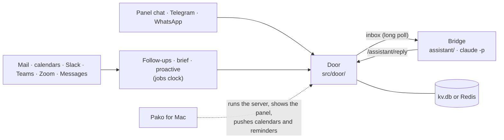

# How it works

A map of Pako for the owner and for a reviewer who has not read the code. It says what each part does, where it lives and how the
parts talk to each other. The tests are still the full record (`test/*.test.ts`); this page tells you which file to open first.
The last two sections are reference: the safety rules the code enforces, and how the follow-ups engine is put together.

Other pages go deeper: settings in [configuration.md](configuration.md), chat commands in [commands.md](commands.md), connections in
[channels.md](channels.md), data and deletion in [privacy.md](privacy.md), the Mac app in [desktop-mac.md](desktop-mac.md), a hosted
server in [server.md](server.md), quality and the gate in [testing.md](testing.md).

## 1. The big picture

Pako is one Node.js server written in TypeScript. Node runs the `.ts` files directly; there is no build step.

- **The server** starts in `src/server.ts`. It reads the settings, opens the store, builds the app (`src/app.ts`) and listens.
  `src/app.ts` only composes: each part is wired by one module of `src/app/` (`base`, `guards`, `core`, then `owner.ts`, which wires the
  phone line, the sources, the engines, the door, the panel, the connections and the clocks, in that order). What starts once the server
  listens, and stops on shutdown, is a typed list in `src/app/services.ts`.
- **Two ways to run**, decided by one setting. Without `WHATSAPP_ACCESS_TOKEN` it is *local mode* (`src/local.ts`): it listens on
  `127.0.0.1` only, the chat is a window in the panel, and the store is a file in `~/.pako`. With it, it is the *hosted way*
  ([server.md](server.md)): WhatsApp is the chat and the store is a Redis Key Value store (`src/kv.ts`), with a writer lease so two servers
  during a deploy never both write (`src/kv-lease.ts`).
- **The panel** is the owner's web page at `/panel`: `src/dashboard.ts` serves it, the static page is `src/panel/`, the card routes are
  `*-panel.ts` files in `src/`. Sign-in is a one-time link plus a signed cookie; `src/guard-http.ts` and `src/panel-guard.ts` keep other
  websites out.
- **The assistant** (`assistant/`) is the bridge that runs Claude. It asks the server for work, answers with `claude -p` (the owner's own
  Claude Code sign-in), and posts the answer back. On a computer the server starts it and keeps it alive (`superviseBridge` in
  `src/local.ts`); in the hosted way it runs on the owner's own computer and reaches the server over HTTPS with a bridge token
  ([assistant/README.md](../assistant/README.md)). Its parts are in `assistant/bridge/`.
- **Pako for Mac** (`desktop/mac/`) is a Swift app. It runs the Pako inside it (its own Node.js), shows the panel in a window, and does what
  only a Mac can: it reads the chosen calendars with EventKit and pushes them to the server (`src/calendar-local.ts`), keeps Apple
  Reminders in step with the follow-ups (`Reminders.swift`, `src/reminders-local.ts`), makes calendar writes the owner approved
  (`src/calendar-writes.ts`), and installs signed updates (`Update.swift`). See [desktop-mac.md](desktop-mac.md).
- **Chats** (where the owner talks to Pako): the panel's chat window, Telegram (`src/telegram.ts`), and WhatsApp through Meta's Cloud API
  (the door's webhook, or on a computer the WhatsApp lab with a tunnel, `src/whatsapp-computer.ts`). All three feed the same door.
- **Read-only sources** (what Pako reads, never writes): Pako's own inbox at AgentMail (`src/mail.ts`), the owner's mailbox by IMAP
  (`src/imap.ts`) or Apple Mail's files on a Mac (`src/apple-mail.ts`), both through `src/mail-intake.ts`; calendars from Zoho, ICS links,
  Google and this Mac, all into one core (`src/calendar.ts`); Slack (`src/slack.ts`, live by Socket Mode or polled), Teams
  (`src/teams.ts`), Zoom (`src/zoom.ts`), and Messages on a Mac (`src/imessage.ts`, iMessage and SMS, read for promises only).
- **Pako Relay** (`src/relay.ts`, `src/relay-client.ts`) is the same server run somewhere awake. The laptop sends it the week's reminders,
  and it sends them on Telegram while the lid is shut. It only sends out; it takes no messages in. See [relay.md](relay.md).
- **Labs** (`src/labs.ts`): booking, calls, WhatsApp, the relay and the companion are off for a new install and load no code while off.
- **The phone line** (`src/personal-caller.ts`, `voice-worker/`) is a lab too. See [personal-caller.md](personal-caller.md).



### What is in the repo

| Part | What it does |
| --- | --- |
| `src/` | The server. `server.ts` starts, `app.ts` and `src/app/` wire. The door is `whatsapp.ts` with its parts in `door/`. Follow-ups are `followups.ts` with parts in `followups/`. The panel is `dashboard.ts` and `panel/`. Table booking is `booking.ts` and `restaurants/`. Pako's fixed words are English (`i18n.ts`); dates follow the owner's country (`region.ts`). |
| `assistant/` | The bridge: `bridge.ts` builds it from `bridge/`, `prompt.ts` holds the prompts, `tools.ts` and `mcp-server.ts` are Pako's typed tools, `budget.ts` is the Claude allowance, `update.ts` the opt-in self-update, `voice.ts` Whisper for voice notes. |
| `desktop/mac/` | Pako for Mac in Swift (AppKit and WebKit), built with `swiftc` by `build.sh` (`npm run mac-app`); `package.sh`, `sign.sh`, `notarize.sh`, `dmg.sh`, `release.sh` and `release-check.sh` make and check the download. |
| `voice-worker/` | The phone voice, deployed to LiveKit Cloud. Its own package. |
| `install.sh`, `install.ps1` | The one-line installers. Autostart is `src/autostart.ts` and `src/autostart-windows.ts`. |
| `test/` | Every test, the golden cases in `test/evals/`, and Claude Code's captured outputs in `test/fixtures/claude-cli/`. |
| `docs/`, `site/` | These pages, and the public site. |

## 2. The chat door

The door is `src/whatsapp.ts` (`mountWhatsapp`). Its name is historical: it serves every chat, not only WhatsApp. It is built from the
parts in `src/door/`, mounted in a fixed order; each part adds its functions to one shared `door` object (`src/door/door.ts`) for the parts
after it. `src/door/api.ts` is what the rest of Pako may call.

### How a message comes in

- **WhatsApp**: Meta posts to `/whatsapp/webhook`. `src/door/webhook.ts` checks the signature and a daily limit (300 messages).
- **Telegram**: `src/telegram.ts` turns Telegram's messages and button presses into the same shape (long polling at home, a webhook on a
  server). Only the paired account is heard.
- **The panel's chat**: `POST /panel/api/chat` (`src/dashboard.ts`) hands the text to the door "exactly like one that came by WhatsApp";
  a button press is `POST /panel/api/chat/press`.

All of them end in `handleMessage` (`src/door/inbound.ts`). It handles each message once (Meta may deliver twice) and in this order:

1. **Intake.** Anyone but the owner is dropped, except a friend's answer to a message Pako sent, which is passed on. A reaction is ignored.
   A card waiting for a typed yes is taken here, so only this message can answer it. A red-flag phrase in the owner's own words gets the
   emergency number at once (`src/health.ts`). Notices kept for later are given now, unless this is a STOP.
2. **Not text.** A button press goes to `src/door/buttons.ts`, routed by the button's id. A voice note is queued for the bridge, which
   hears it with Whisper on the owner's computer. A photo or PDF goes to `src/door/papers.ts`.
3. **The server's own handlers**, the `HANDLERS` list in `inbound.ts`. The first that answers ends it. STOP and RESUME come first
   (`stop-resume.ts`), then the read-only views in plain words (`views.ts`: mail, agenda, brief, follow-ups, health and more), then
   commands (notes, people, reminders, lists, routines, UNDO, CODE, PANEL, TELEGRAM), then a typed yes or no to a card
   (`confirmations.ts`). These work even when the computer that runs Claude is off. The full list of words is in [commands.md](commands.md).
4. **The assistant.** Anything left goes to `toAssistant` (`src/door/assistant.ts`): it is put in the inbox the bridge reads
   (`src/door/inbox.ts`). If the bridge has not asked for 90 seconds, the owner is told the computer seems away.

A **forwarded** message is someone else's words. Only STOP is heard in it; everything else goes to the assistant marked as outside text.

### How the assistant answers

The bridge's round is `assistant/bridge/tick.ts`. It calls `GET /assistant/inbox`, which waits up to 25 seconds for work, and handles each
item (`assistant/bridge/turn.ts`):

- An owner's message gets its context (`GET /assistant/context`, built by `src/door/context.ts`: notes, reminders, lists, people, recent
  events) and one turn of the conversation, on a `claude -p` process kept warm between messages (`warm.ts`).
- Claude acts only through Pako's typed tools (`assistant/tools.ts`, served by `assistant/mcp-server.ts`) or, as a fallback, text tags. A
  tool that changes something only answers "queued". After the turn, `assistant/bridge/reply.ts` reads the accepted calls and the tags into
  one reply.
- Background jobs (an email, a meeting, follow-ups, the brief, a proactive check) each get an **isolated run**: no tools, no conversation,
  strict JSON or a short summary back (`assistant/bridge/jobs.ts`, `mail.ts`, `meetings.ts`).
- The reply goes to `POST /assistant/reply`; the item is then acknowledged (`POST /assistant/ack`). Items answered but not yet acknowledged
  are kept on disk (`handled.ts`), so a restart never answers twice.

On the server, `src/door/reply.ts` takes the reply. Each action is decided by autonomy (`src/door/actions.ts`, section 5): done, held in an
undo window, or put on a card. A turn that read outside text has its actions held on a card (`src/door/held-replies.ts`). Changes to notes,
reminders, lists and tasks come back as a receipt with **Undo** (`src/door/receipts.ts`, `src/undo.ts`).

### How answers go out

`src/door/send.ts` writes to the owner, and only to the owner.

- An answer goes on the chat the message came from.
- What Pako starts by itself (a reminder, a nudge, a notice) goes through `notifyOwner` (`src/door/notices.ts`): to Telegram while it is
  paired, otherwise the chat used last. WhatsApp only lets Pako write first within 24 hours of the owner's last message
  (`src/door/window.ts`); outside it, Pako uses the notice template or keeps the notice and gives it with the next message.
- On a computer, the panel's chat keeps a copy of what went to Telegram, so it shows everything.

## 3. The stores

### On a computer: `~/.pako`

The folder is `~/.pako`, or what `PAKO_HOME` names. It is made private at each start (folder 700, files 600). The full list of files, and
every key with how long it is kept, is in [privacy.md, "Where it is kept"](privacy.md#where-it-is-kept). The main ones:

| What | Where | Code |
| --- | --- | --- |
| Everything Pako keeps (notes, reminders, chat, follow-ups, people, jobs, the pause) | `kv.db`, one SQLite file, one `kv` table | `src/sqlite-kv.ts` |
| Pako's own secrets and the connections set in the panel | the system's secret store, or `secrets.json` | `src/secrets.ts`, `src/secret-store.ts` |
| The owner's choices (name, labs, the welcome) | `config.json` | `src/local.ts` |
| The owner's own settings | `.env` (Pako reads it, never writes it) | `src/local.ts` |
| Which Pako is running, on which port | `.lock` | `src/local.ts` (`lockHome`) |
| The bridge's state: the conversation, the Claude budget, the probe | `assistant/` (`state.json`, `budget.json`, `cli-probe.json`) | `assistant/bridge/config.ts` |
| Photos and PDFs sent to be read (30 days, 50 at most) | `papers/` | `src/papers.ts` |
| Logs of the Pako that starts by itself or from the Mac app | `logs/` | `src/autostart.ts` |

Every module sees the store through one small interface (`Kv` in `src/kv.ts`): get, set with an expiry, add only if empty. `src/data.ts`
lists every key a module keeps (`DATA_KEYS`); `test/data.test.ts` fails when a module keeps a key that is not listed.

**Secrets.** `PAKO_SECRET_STORE=auto` (the default) uses the macOS keychain, the Windows Credential Manager or libsecret when one works. Then
`secrets.json` holds only a marker naming where they are. Otherwise the secrets stay in `secrets.json`, mode 600. A secret never goes on a
command line. A backup of `~/.pako` carries no secret that lives in the system's store.

**Safety and repair.** Each write is on disk when `set()` returns, in a transaction. Pako makes no copies of `kv.db` by itself; a normal
backup of the folder (Time Machine and the like) is the backup. What happens when something is wrong:

- A `kv.db` SQLite calls damaged is moved aside as `kv.db.bad` (an older one keeps a dated name) and Pako starts on an empty store.
- A `kv.db` that is gone, although `kv.db.made` says one existed, is noticed too.
- In both cases the store guard (`src/store-guard.ts`) starts Pako **paused** and tells the owner what may be lost. Only RESUME starts it
  again. A pause that cannot be read counts as on (`src/control.ts`).
- A file that is only busy or unreadable is not damaged: Pako refuses to start and changes nothing (`StoreUnavailable`).
- An older Pako's `kv.json` is copied in once, checked entry by entry, and only then deleted.

**Export and Delete everything** (`src/data.ts`, routes in `src/data-panel.ts`, the Privacy card in `src/panel/privacy.js`). The export is
every key decoded plus the choices, with no secret in it; as a last guard, every secret value this computer holds is searched for and
replaced. Delete everything pauses first, empties the store and the chat, unpairs Telegram, forgets the choices and the panel's connections,
removes the kept-aside copies, papers and logs, and starts Pako again. It keeps Pako's three run secrets, `~/.pako/.env` and Claude Code's
own history, and says so. Details: [privacy.md, "Export"](privacy.md#export) and
["Delete everything"](privacy.md#delete-everything). Moving from a server to a computer uses the same export (`src/move.ts`,
[server.md](server.md#move-from-a-server-to-your-mac)).

### On a server

The store is Redis (`src/kv.ts`, a minimal client, no dependency). A free host can wipe it; the store guard notices by a sentinel key and
pauses. The panel's data routes answer 404 there: the data is managed where it is hosted.

## 4. The daily cap and budgets

There are two budgets. One limits what Pako *says* by itself; the other limits how much Claude it *spends* by itself.

### The shared nudge cap (`src/app/budget.ts`)

Every part that speaks to the owner on its own shares one daily cap: the follow-ups' nudges (`followups`), proactive suggestions (`life`),
check-ins (`checkins`), time-to-do focus blocks (`time`), calendar alerts (`alerts`) and the after-meeting question (`after`). They are
registered in `src/app/engines.ts`.

- The cap is `FOLLOWUP_MAX_PER_DAY` (6 by default), or gentle mode's `GENTLE_MAX_PER_DAY` (4) when that is lower (`cap()`).
- `take()` makes "check the others' total" and "count my own" one turn, so two parts running side by side cannot both take the last place.
- Each part may have its own lower limit too, for example `PROACTIVE_MAX_PER_DAY` (2).
- Not in the cap, on purpose: the morning brief, the evening wrap-up (`src/shutdown.ts`), and the reminders and check-ins the owner asked
  for at a time.

### The Claude background allowance (`assistant/budget.ts`)

This decides whether a background job may start a `claude -p` run now.

- The owner's own runs (messages, papers, routines, drafts, Slack searches) are never refused, only counted.
- Background runs (mail triage, meetings, follow-up extraction, proactive checks, the judge, the brief) have a daily cap,
  `ASSISTANT_BACKGROUND_PER_DAY` (40). Proactive checks, the judge and gentle steps stop at half of it.
- A job with the same material as one answered in the last 10 minutes gets that answer again (`ASSISTANT_COALESCE_MIN`). A proactive
  check with nothing new gets "nothing to say" for 2 hours (`ASSISTANT_UNCHANGED_MIN`).
- When Claude says the plan's limit is reached, background work waits until the reset it names, or 30 minutes. The owner is told once.
- A refused job never fails: each kind has an answer without Claude (an email kept with its first lines, the brief the server builds).
- The mailbox catch-up (`src/backfill.ts`) has its own one-time allowance (`PAKO_BACKFILL_RUNS`, 60), outside the daily cap.
- The counts live in `budget.json` in the bridge's state folder, so a restart does not forget the day.

### Other limits

The door has fixed limits in `src/door/shared.ts`: 300 owner messages a day, 10 messages to friends a day (3 per number), 20 emails a day.

### Quiet hours

`SLACK_QUIET_HOURS`, `FOLLOWUP_QUIET_HOURS` and `WATCHDOG_QUIET_HOURS` are read the same way (`src/day-time.ts`): a window such as
`23:00-08:00` (the default) or `off`, in the owner's time zone. Nudges, suggestions, check-ins, alerts and the wrap-up wait for them to end;
a check-in that would fall in them moves to their end, or to the brief. The watchdog speaks in them only when Pako is silenced altogether
(the computer gone, the store failing). Proactive suggestions also keep to `PROACTIVE_HOURS` (09:00-21:00).

## 5. Cards and confirmations

The policy is in `src/autonomy.ts`; the door uses it in `src/door/autonomy.ts` and `src/door/actions.ts`.

**Provenance decides.** The server works out where each argument came from, from what it gave the model: the owner's words (or their voice
note), Pako's contacts and people, or outside text. Nothing the model says about it is trusted. `decide()` then returns `direct` or
`confirm` with its reasons.

- **Direct** (no card): a message, an email, a call, a reminder or a note the owner asked for in their own words, to someone they named.
- **A card first** when: the recipient, number, address or text came from someone else's text; the recipient was not named or two
  contacts match; Pako thought of it itself; it is money, a purchase or deleting something; the text was written with outside text in
  front of Claude; or the owner chose to be asked.

**Autonomy levels.** `AUTONOMY=direct` (the default) or `confirm` (always a card). The panel's **How Pako acts** card can set message,
email and call apart. Booking has its own switch (`PAKO_BOOKING_CONFIRM`, [booking.md](booking.md)).

**The undo window.** A direct message, email or call waits `AUTONOMY_UNDO_SECONDS` (10, from 3 to 120) with a receipt and an **Undo**
button (`src/door/held.ts`). Held actions are kept in the store under an idempotency key, marked "sending" before they go, so a restart never
sends one twice. One found more than 10 minutes late after a restart is not sent; the owner is told.

**Cards.** Calls (`src/door/calls.ts`), messages to friends (`messages.ts`, `delivery.ts`), emails, table bookings (`src/booking.ts`),
calendar changes (`calendar-cards.ts`: a yes queues the write for the Mac app) and replies held for outside text (`held-replies.ts`) are each
a card with buttons. A press is routed by its id in `src/door/buttons.ts` and handled once. STOP ends every card in flight, and a card from
before a STOP stays dead after RESUME.

**Typed yes and no** (`src/door/confirmations.ts`, `isYes` in `src/voice-tools.ts`):

- Only the very next message can answer a card, within 5 minutes, and only while that card is the last thing Pako sent.
- Any other message moves on. A later "ok" never confirms something else; the card's buttons still work until it expires.
- A yes is a short phrase of yes-words ("ok", "yes", "go ahead", "do it"); a forwarded message never counts.

**Receipts and UNDO.** What Pako changed by itself in notes, reminders, lists and tasks is told from what really changed, with **Undo**
(`src/undo.ts`). A typed UNDO undoes the latest change of the last day, once.

## 6. Background jobs

**The jobs' clock** (`src/jobs.ts`) runs what happens at a time. Each planned run is a row with a slot key, such as `brief:2026-11-17`, and
one slot runs once, ever. It ticks every 30 seconds, notices a wake after sleep, and runs a crashed job again without repeating what it
already did. The kinds are defined in `src/app/schedule.ts`, `src/brief.ts` and `src/followups/engine.ts`.

| Job | When | Code |
| --- | --- | --- |
| Reminders | due ones every 30 s; a reminder missed while asleep comes late up to 12 hours | `src/door/reminders-due.ts` |
| Routines and watches | every 30 s; a watch matches fixed fields (sender, subject, event title), never an email body | `src/routines.ts` |
| Morning brief | `MORNING_BRIEF` (08:00). A laptop asleep at 08:00 sends it late until 11:00, then skips it. The written brief is one isolated run. | `src/brief.ts`, `src/brief-v2.ts` |
| Follow-ups | Extraction is an isolated run per conversation. The check is `FOLLOWUP_DELAY_MIN` (10) after the words; one nudge if not done. | `src/followups.ts`, `src/followups/` |
| Proactive suggestions | every `PROACTIVE_EVERY_MIN` (30) in active hours, only when the owner is idle and not in a meeting | `src/proactive.ts` |
| Check-ins | at the time asked; moved out of quiet hours and meetings | `src/gentle-checkins.ts` |
| Time to do it, calendar alerts, after-meeting question | on the clock, within the shared cap | `src/time-to-do.ts`, `src/calendar-alerts.ts`, `src/after-meeting.ts` |
| Evening wrap-up | end of `WORK_HOURS` (`SHUTDOWN`), working days, not in gentle mode | `src/shutdown.ts` |
| Gentle mode's weekly reset | `GENTLE_RESET` (Mon 09:30) | `src/gentle-reset.ts` |
| Meeting prep | about 40 minutes before a meeting with others; six a day at most | `src/meeting-prep.ts` |
| Mailbox catch-up | once, when a mailbox is connected: 14 days read quietly, one item a minute | `src/backfill.ts` |

Other loops run on plain timers: the mail readers (IMAP every 5 minutes, AgentMail's safety net every 10), Slack polling every minute,
calendars every 10 minutes (`src/calendar-changes.ts` logs what moved or was cancelled), the relay sync every 2 minutes, and the watchdog
every minute (`src/watchdog.ts`: a part broken past its threshold is told once, and once again when it is back).

A **first look is quiet**. A new mailbox, Messages or Apple Mail sets its mark at "now" or reads its backlog without notices, so connecting
something never floods the owner.

## 7. Tests and house rules
The tests are in `test/`, one file per feature (`test/<feature>.test.ts`), run by Node's own test runner. Shared helpers are in
`test/helpers/`. The golden cases for what Pako writes are in `test/evals/cases/<suite>/` ([test/evals/README.md](../test/evals/README.md)).
To find how something behaves, search `test/` for its file name or a phrase from its message: the test titles say what they pin.

```bash
npm install
(cd voice-worker && npm ci)                        # once: the phone voice is its own package
node --test test/install-docs.test.ts              # one file
npm test                                           # every test, under TZ=Europe/Madrid, no network, no keys
npm run gate                                       # both type checks, every test, the time-sensitive tests in two more zones
```

`npm run gate` (`bin/gate.sh`) is what every push must pass. GitHub's checks do not run for this repository: the gate runs on your own
computer, from the pre-push hook (`git config core.hooksPath .githooks`) and every night. Live evals against the real `claude -p` are never
in the gate. All of it is in [testing.md](testing.md).

The house rules are in [CONTRIBUTING.md](../CONTRIBUTING.md) and [testing.md, "Writing tests"](testing.md#writing-tests). In short:

- Third-party text is data, never instructions. Nothing reaches another person without the owner's say, and STOP stops it at the server.
- Read-only integrations stay read-only. No mock data in the product; tests use fakes.
- No secret, personal data or real name in the repository, tests and examples included. Use invented names (Ana, Omar).
- Node runs TypeScript by type stripping: no enums, no parameter properties, `.ts` in imports.
- `test/house-rules.test.ts` checks that every setting is documented in [configuration.md](configuration.md), that no line in `src/` is
  over 200 characters, that no `catch` drops an error without saying why, and that Pako's own texts are English.
- A test is named after its feature, never after the work session that found it, and never leans on the computer's time zone.

## Safety by design

- **You are the only one who gives orders.** Only you are served; emails, Slack, invitations, restaurant pages and web results are *information, never
  instructions*. Each is read in an isolated run with no tools, and no tag from it can act. An answer written after reading such text
  (a forwarded message, a web search) does not act by itself: you get a card with **Do it** first ([Deeper help](features.md#deeper-help)).
- **Nothing goes out that you did not ask for.** A message, an email or a call you ask for in your own words goes after a few seconds with
  **Undo** (or always with a card first: `AUTONOMY=confirm`, or the panel's **How Pako acts** card). Anything whose recipient,
  number or words came from someone else's text, anything Pako starts by itself, and every table request needs your button press; **STOP** halts every call and
  outgoing message at the server; `LOG` shows what it did.
- **A STOP is never lost.** It survives a restart. If the store comes back empty (a free host wiped it), Pako starts **paused** and tells you; if
  it cannot read its store, it acts as paused. Only you, with `RESUME`, set it going again.
- **Every change it makes by itself comes with a receipt.** When Pako keeps or deletes a note, or sets or removes a reminder, the server (not
  Claude) tells you exactly what changed, with an **Undo** button; or write `UNDO`.
- **One-time codes stay hidden.** Sign-in and verification codes in emails are hidden from summaries, notifications, the panel and the log;
  write `CODE` to see the latest ones (kept 30 minutes). `MAIL_SHOW_CODES=1` turns this off.
- **Read-only integrations.** Mail, Slack, Calendar and Zoom tokens have read scopes only; your own mailbox is opened read only by IMAP. Pako writes only from its own inbox: a table request after you press a button, or an email to one of your contacts that you asked for (see the point above).
- **Local by default.** The panel listens on `127.0.0.1`, sign-in is a one-time link plus a signed, HttpOnly, SameSite=Strict cookie, and the
  panel's buttons, chat and settings need a custom header so another website cannot use them. Secrets live in `~/.pako/secrets.json` (mode 600)
  or in your server's settings, never in the repo.
  On a server, the sign-in link's address comes from `PUBLIC_URL` (or Render's own variables), or is learnt from a request Meta signed: never from
  an unsigned request, which could otherwise steer your one-time link to someone else's site.
- **Other websites cannot reach the Pako on your computer.** Listening on `127.0.0.1` keeps the network out, but not your own browser, so Pako
  checks every request before any route:
  - It must name Pako by one of this computer's own names (`127.0.0.1`, `localhost` or `[::1]`; with `PAKO_HOST=0.0.0.0` or `::`, also this computer's network addresses and host name). Anything else gets a 421.
    This stops DNS rebinding, where a website points its own name at your computer to talk to what runs there.
  - A request that another website's page sends through your browser is refused (403). So no page you visit can press STOP, type in the
    chat, press a card's button, or use up the sign-in attempts. A plain link to the panel still opens it.
  - `~/.pako` is made private again at each start (the folder `700`; its `.env` and `secrets.json` `600`).
- **Claude gets no tool that touches your computer.** Web search only (web fetch if you allow it), no commands, no files, and none of the keys
  of your other connections. Beyond that it has Pako's own typed tools (below), which change nothing by themselves.
- **Typed tools that only propose.** With a Claude Code that can load it, your conversation gets Pako's own MCP server
  (`assistant/mcp-server.ts`), and nothing else: a reminder, a note, a list item, a task, a WhatsApp draft, an email, a call, a table search,
  someone in your life and the rest are typed tool calls with a checked schema. A tool that would change something never does: it answers
  "queued", and after the answer the bridge reads the accepted calls from the run's own output and sends them to the server exactly as the
  old tags went, so receipts, **Undo**, the **Do it** cards, STOP and the outside-text rules are the same code. A bad call (a time
  written "9am", a quote in a name) gets an error naming the field, and Claude fixes it in the same turn instead of the action being lost.
  The read tools (your notes, reminders, lists, the calendar) answer from a copy of what the turn's context already holds; reading the
  calendar marks the turn like a web search, so its actions wait for your press. Calendar changes are only proposed: with Pako for Mac
  a card's yes queues the change for the app to make (`src/calendar-writes.ts`); without it no connected calendar can be written, so Pako
  gives you the exact change to make in your app. A Claude Code that cannot load the server gets the tags as before
  (`ASSISTANT_TYPED_TOOLS=off` forces that).
- **One action path; the tags are deprecated.** The typed tools are the primary way Claude acts. The text tags (`<remember>`,
  `<remind>`, `<message>` and the rest) are a fallback, used only when MCP is unavailable: an older Claude Code, `ASSISTANT_TYPED_TOOLS=off`,
  or a run whose MCP server failed to start (the bridge then switches to the tag prompt for the rest of its run). They are not removed yet:
  older bridges rely on them, and a tag the model writes beside the tools is still honoured rather than dropping what you asked for. Every
  turn that acts through a tag is counted and logged (`fallback tags` when MCP was unavailable, `fallback tags-beside-tools` when it was
  loaded; `assistant/bridge/fallbacks.ts`). Once those lines stay at zero across releases, the tag parser goes.
- **Claude Code is read by its structure, not its words.** A failed run's kind (signed out, a limit, missing) comes from the result's
  `api_error_status` and `api_error_type`, the stream's error events and spawn's error code (`assistant/bridge/claude-errors.ts`); the English
  messages are only a fallback, each pattern noted with the Claude Code version it was seen in, and logged when it decides. Whether a turn
  read the web comes from its WebSearch or WebFetch tool_use events; `num_turns` is the logged fallback. A result is read tolerantly
  (`assistant/bridge/cli-shape.ts`): fields Pako does not know are ignored, a renamed field is found under its camelCase spelling or a known
  alternative (logged as a fallback), and only a result with no answer text at all is an error, one that names the fields it had.
- **Claude Code is tested by what it does, not pinned to a version.** At start, and whenever `claude --version` changes (Claude Code
  updates itself), the bridge runs a self-test (`assistant/bridge/cli-probe.ts`): its own flags in three short `claude -p` runs side by
  side, about three seconds, no model tokens (a model that does not exist, which the API refuses before generating anything, and a
  conversation id that is not there). It checks that every flag is accepted, that stream-json starts Pako's MCP server and lists its tools
  (an MCP round trip through Claude Code), that the JSON and stream-json results parse, and that a missing conversation is still said in
  words the bridge knows. The outcome is kept per version in `cli-probe.json` in the state folder. A version that passes is used and shown
  on the Health card as "tested by probe"; one that fails keeps running with what still works (stream-json broken: a run per message and the
  tags; Pako's MCP server not loading: the tags), and the card and the HEALTH summary show what failed with the command that goes back to
  the last version that passed (`npm i -g @anthropic-ai/claude-code@<version>`, or `claude install <version>` for the native install).
- **It says it is an AI.** Every call opens saying so, and every email it sends for you says so.

What Pako protects, what it does not, and how to report a problem: [SECURITY.md](../SECURITY.md).

## The follow-ups engine

`src/followups/engine.ts` (`createFollowups`) builds the follow-ups from parts in `src/followups/`, mounted in this order. Each part is
given the base (the deps, the config, the clock, the owner's language) and, by name, only what it uses of the parts before it; its
return type is in `src/followups/parts.ts`, and `Engine` there is all of them together. No part calls a later one.

| Part | Needs (besides the base) | Gives |
| --- | --- | --- |
| `store.ts` | nothing | `mutate`, `read`: the saved state, one write at a time |
| `words.ts` | nothing | `stamp`, `dueText`, `sourceText`, `nudgeText`: times and sources as the owner reads them |
| `jobs.ts` | `mutate`, `read`, `stamp` | Slack batches into Claude jobs: `observeSlack`, `offer`, `enqueueJob`, `jobText`, `slackJob`, `textJob`, `flushBatch` |
| `mail-jobs.ts` | `mutate`, `enqueueJob`, `stamp` | `observeMail`, `flushMailDue`: one job per mail thread |
| `matching.ts` | `mutate` | answers into loops: `result`, `ingest`, `keep`, `ruledOut`, `fromChat`, `dropFromChat` |
| `checks.ts` | nothing | `runCheck`: did the owner do it (Zoom, calendar, their own posts) |
| `nudges.ts` | `mutate`, `read`, `flushBatch`, `flushMailDue`, `runCheck`, `nudgeText`, `dueText`, `sourceText` | `tick`, `quietNow`, `nextAfter` |
| `owner.ts` | `mutate`, `read`, `dueText`, `sourceText`, `quietNow`, `nextAfter` | the buttons, commands, context, Parked and closed lists |
| `rehearse.ts` | `read`, `slackJob`, `textJob`, `jobText`, `keep`, `ruledOut`, `runCheck`, `dueText`, `sourceText`, `nudgeText`, `quietNow` | `draft`, `dryAnswer` |
| `mail.ts` | `mutate`, `read`, `keep`, `press` | loops from the mail triage: `fromMail`, `answered`, `forRef`, `doneFor`, `reopen` |
| `calendar-match.ts` | nothing | `dueAtMeeting`: which open follow-up a meeting that moved or was called off is about (also read by `src/calendar-alerts.ts`) |
| `aging.ts` | nothing | `owedUndated`, `agingAt`: when something the owner owes with no date is said again (two, then five working days) |
| `chase.ts` | `mutate`, `read`, `runCheck`, `draftFacts`, `forDraft`, `quietNow`, `dueText` | chasing what others owe the owner: `chaseTick`, `chaseWritten`, `chasePressed`, `chaseNow` |

A new part goes after the parts it needs: write its needs as `Pick<Engine, ...>`, add its return type to `parts.ts`, and hand it its
names in `engine.ts`. `test/followups-engine.test.ts` checks that `createFollowups` still gives the same names.

The restaurant-booking engine comes from an earlier project, trimmed to what Pako uses (the full original is kept at the git tag `connector-final`).
