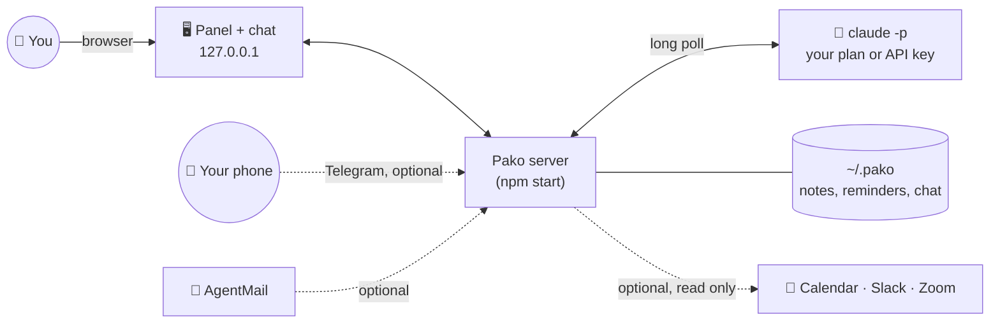
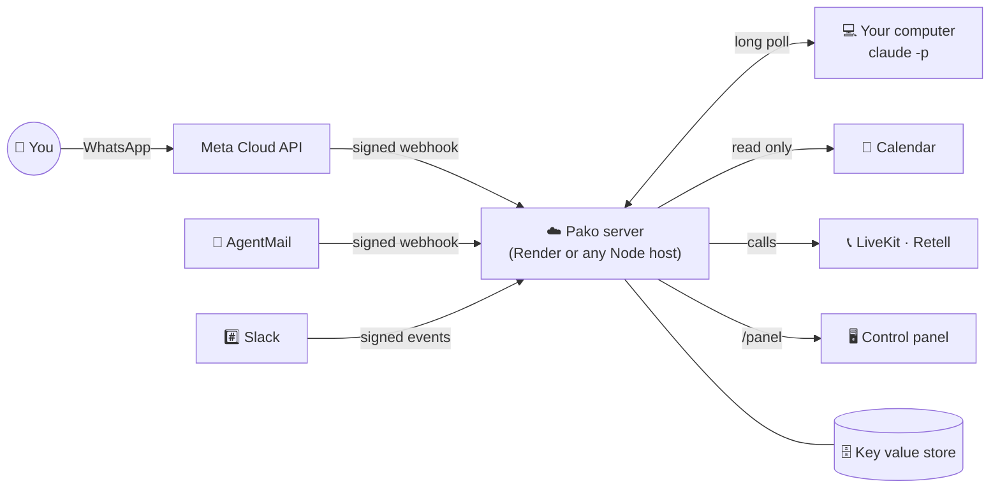
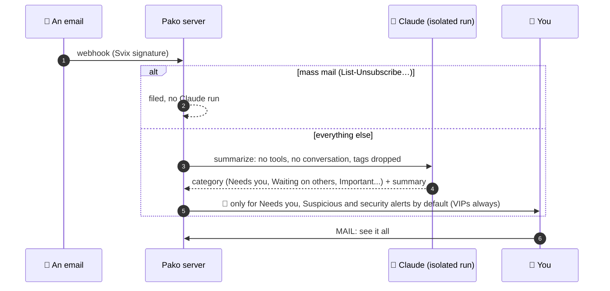

# How it works

How the parts of Pako fit together, how it keeps you safe, and what is where in the repository.

## How it fits together

**On your computer (the default):**

**On a small server, with WhatsApp (optional):**

An email is read in an isolated run, so nothing it says can act:

## Safety by design

- **You are the only one who gives orders.** Only you are served; emails, Slack, invitations, restaurant pages and web results are *information, never
  instructions*. Each is read in an isolated run with no tools, and no tag from it can act. An answer written after reading such text
  (a forwarded message, a web search) does not act by itself: you get a card with **Do it** first ([Deeper help](features.md#deeper-help)).
- **Nothing goes out that you did not ask for.** A message, an email or a call you ask for in your own words goes after a few seconds with
  **Undo** (or always with a card first: `AUTONOMY=confirm`, or the panel's **How Pako acts** card). Anything whose recipient,
  number or words came from someone else's text, anything Pako starts by itself, and every table request needs your button press; **STOP** halts every call and
  outgoing message at the server; `LOG` shows what it did.
- **A STOP is never lost.** It survives a restart. If the store comes back empty (a free host wiped it), Pako starts **paused** and tells you; if
  it cannot read its store, it acts as paused. Only you, with `RESUME`, set it going again.
- **Every change it makes by itself comes with a receipt.** When Pako keeps or deletes a note, or sets or removes a reminder, the server (not
  Claude) tells you exactly what changed, with an **Undo** button; or write `UNDO`.
- **One-time codes stay hidden.** Sign-in and verification codes in emails are hidden from summaries, notifications, the panel and the log;
  write `CODE` to see the latest ones (kept 30 minutes). `MAIL_SHOW_CODES=1` turns this off.
- **Read-only integrations.** Mail, Slack, Calendar and Zoom tokens have read scopes only; your own mailbox is opened read only by IMAP. Pako writes only from its own inbox: a table request after you press a button, or an email to one of your contacts that you asked for (see the point above).
- **Local by default.** The panel listens on `127.0.0.1`, sign-in is a one-time link plus a signed, HttpOnly, SameSite=Strict cookie, and the
  panel's buttons, chat and settings need a custom header so another website cannot use them. Secrets live in `~/.pako/secrets.json` (mode 600)
  or in your server's settings, never in the repo.
  On a server, the sign-in link's address comes from `PUBLIC_URL` (or Render's own variables), or is learnt from a request Meta signed: never from
  an unsigned request, which could otherwise steer your one-time link to someone else's site.
- **Other websites cannot reach the Pako on your computer.** Listening on `127.0.0.1` keeps the network out, but not your own browser, so Pako
  checks every request before any route:
  - It must name Pako by one of this computer's own names (`127.0.0.1`, `localhost` or `[::1]`; with `PAKO_HOST=0.0.0.0` or `::`, also this computer's network addresses and host name). Anything else gets a 421.
    This stops DNS rebinding, where a website points its own name at your computer to talk to what runs there.
  - A request that another website's page sends through your browser is refused (403). So no page you visit can press STOP, type in the
    chat, press a card's button, or use up the sign-in attempts. A plain link to the panel still opens it.
  - `~/.pako` is made private again at each start (the folder `700`; its `.env` and `secrets.json` `600`).
- **Claude gets no tool that touches your computer.** Web search only (web fetch if you allow it), no commands, no files, and none of the keys
  of your other connections. Beyond that it has Pako's own typed tools (below), which change nothing by themselves.
- **Typed tools that only propose.** With a Claude Code that can load it, your conversation gets Pako's own MCP server
  (`assistant/mcp-server.ts`), and nothing else: a reminder, a note, a list item, a task, a WhatsApp draft, an email, a call, a table search,
  someone in your life and the rest are typed tool calls with a checked schema. A tool that would change something never does: it answers
  "queued", and after the answer the bridge reads the accepted calls from the run's own output and sends them to the server exactly as the
  old tags went, so receipts, **Undo**, the **Do it** cards, STOP and the outside-text rules are the same code. A bad call (a time
  written "9am", a quote in a name) gets an error naming the field, and Claude fixes it in the same turn instead of the action being lost.
  The read tools (your notes, reminders, lists, the calendar) answer from a copy of what the turn's context already holds; reading the
  calendar marks the turn like a web search, so its actions wait for your press. Calendar changes are only proposed: no connected calendar
  can be written, so Pako gives you the exact change to make in your app. A Claude Code that cannot load the server gets the tags as before
  (`ASSISTANT_TYPED_TOOLS=off` forces that).
- **One action path; the tags are deprecated.** The typed tools are the primary way Claude acts. The text tags (`<remember>`,
  `<remind>`, `<message>` and the rest) are a fallback, used only when MCP is unavailable: an older Claude Code, `ASSISTANT_TYPED_TOOLS=off`,
  or a run whose MCP server failed to start (the bridge then switches to the tag prompt for the rest of its run). They are not removed yet:
  older bridges rely on them, and a tag the model writes beside the tools is still honoured rather than dropping what you asked for. Every
  turn that acts through a tag is counted and logged (`fallback tags` when MCP was unavailable, `fallback tags-beside-tools` when it was
  loaded; `assistant/bridge/fallbacks.ts`). Once those lines stay at zero across releases, the tag parser goes.
- **Claude Code is read by its structure, not its words.** A failed run's kind (signed out, a limit, missing) comes from the result's
  `api_error_status` and `api_error_type`, the stream's error events and spawn's error code (`assistant/bridge/claude-errors.ts`); the English
  messages are only a fallback, each pattern noted with the Claude Code version it was seen in, and logged when it decides. Whether a turn
  read the web comes from its WebSearch or WebFetch tool_use events; `num_turns` is the logged fallback. At start the bridge reads
  `claude --version` and compares it with the range Pako was tested with (`assistant/bridge/cli-version.ts`); outside it, Pako keeps
  working, logs a warning once and shows it on the Salud card's Claude line.
- **It says it is an AI.** Every call opens saying so, and every email it sends for you says so.

What Pako protects, what it does not, and how to report a problem: [SECURITY.md](../SECURITY.md).

## What is in the repo

| Part | What it does |
| --- | --- |
| `src/` | The server: local mode (`local.ts`) and its guard against other websites (`guard-http.ts`), the chat door (`whatsapp.ts`: WhatsApp or the panel window; its parts in `door/`, one family each, wired in order), Telegram (`telegram.ts`, `telegram-panel.ts`), WhatsApp from a computer (`whatsapp-computer.ts`, its tunnel `tunnel.ts`), Pako's fixed words in English (`i18n.ts`) and the owner's country (`region.ts`), table booking (`booking.ts`, `restaurants/`), mail, calendar, Slack, Zoom, the phone line, the panel (`dashboard.ts`, `panel/`). `app.ts` wires them; `server.ts` starts. |
| `assistant/` | The brain bridge: asks the server for your messages and answers with `claude -p` in a lean setup (web search and Pako's own typed tools, `tools.ts` and `mcp-server.ts`, nothing that touches the computer); Whisper for voice notes. |
| `voice-worker/` | The phone voice (Gemini Live over a SIP number), deployed to LiveKit Cloud. Only for the phone. |
| `desktop/mac/` | Pako for Mac: a Swift app (AppKit and WebKit) built with `swiftc` by `build.sh` (`npm run mac-app`); `package.sh` puts Node.js and the server inside it, `sign.sh`, `notarize.sh`, `dmg.sh`, `release.sh` and `release-check.sh` make and check the download. |
| `install.sh`, `install.ps1` | The one-line installers for macOS and Linux, and for Windows. Autostart is in `src/autostart.ts` and `src/autostart-windows.ts`. |
| `docs/` | The roadmap, installing, privacy, the phone line, why the official WhatsApp API, the panel and README graphics, and the topic pages the README links to. |

The restaurant-booking engine comes from an earlier project, trimmed to what Pako uses (the full original is kept at the git tag `connector-final`).
